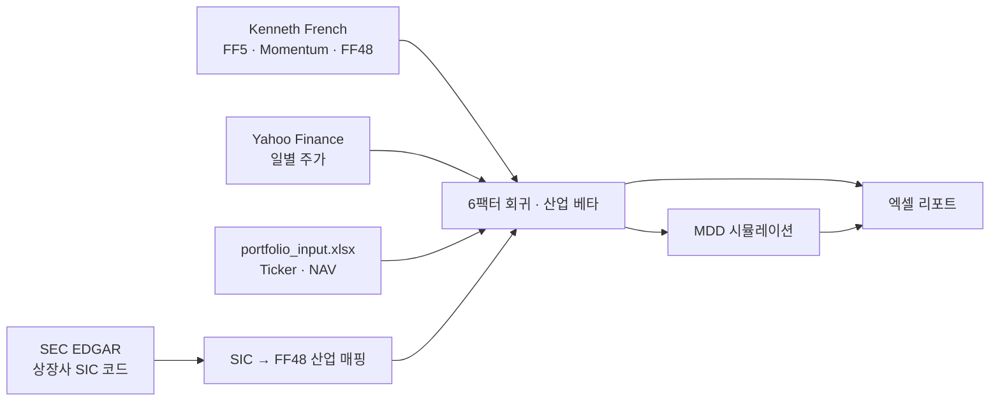

# Portfolio Factor Risk Automation

보유 종목을 엑셀에 입력하면 **6팩터 베타, 산업 베타, 리스크 기여도, 예상 최대낙폭(MDD)** 을 계산해 엑셀 리포트로 만들어 주는 Python 자동화 도구입니다. 매월 1일 데이터 갱신과 리포트 생성이 자동으로 실행되고, 입력 엑셀을 저장하면 리포트가 바로 다시 만들어집니다.

## 무엇을 계산하나

| 리포트 시트 | 내용 |
|---|---|
| **Asset_Betas** | 종목별 6팩터 베타 (시장·규모·가치·수익성·투자·모멘텀) + 산업 베타 (시장 효과 제외) |
| **Factor_Regression** | 일별 6팩터 동시 회귀 결과. 알파 95% 신뢰구간, 유의한 베타는 색으로 표시 |
| **Factor_Risk** | 일별 분산 중 팩터별 비중과 고유 리스크 비중 (합계 100%) |
| **Daily_Risk** | 종목별 변동성, 포트폴리오 리스크 기여도, 상관·공분산 행렬 |
| **Expected_MDD** | 향후 1년 예상 MDD와 원금 대비 최대손실 (5,000개 경로 시뮬레이션) |
| **Factor_Diagnostics** | 팩터 간 상관계수와 VIF (다중공선성 점검) |
| **Rolling_Betas** | 최근 1년 창으로 다시 추정한 월말 베타 추이 차트 |
| **Test_Comparison** | 현재 포트폴리오와 바꿔보고 싶은 포트폴리오(Test) 비교 |
| **Data_Quality** | 다운로드 오류, 결측, 거래량 0, 같은 종가 연속 등 데이터 점검 |

## 데이터 흐름



## 방법론

### 팩터 베타
- **6팩터 동시 회귀**: Fama-French 5팩터(Mkt-RF, SMB, HML, RMW, CMA)와 모멘텀(Mom)을 일별 초과수익률에 한 번에 회귀합니다. 팩터를 하나씩 따로 회귀하면 팩터 간 상관 때문에 베타가 부풀려지기 때문에, 예전 방식은 비교용 참고 시트로만 남겼습니다.
- **Dimson 보정**: 전일 팩터 수익률을 함께 넣고 당일·전일 계수를 더해 베타를 구합니다. 거래가 드문 종목의 베타가 낮게 잡히는 문제를 줄입니다.
- **Newey-West 표준오차**: 일별 잔차의 이분산과 자기상관을 반영해 유의성이 과대평가되지 않도록 했습니다.
- **산업 베타**: SEC EDGAR 공시 데이터로 미국 상장사의 SIC 코드를 Fama-French 48개 산업에 매핑하고, 시장 효과를 제외한 산업 노출을 계산합니다.

### 예상 MDD 시뮬레이션
- **블록 부트스트랩**: 과거 일별 수익률을 21거래일(약 한 달) 블록으로 뽑습니다. 모든 종목에 같은 날짜를 사용해 종목 간·팩터 간 상관관계를 유지합니다.
- **추정 오차 반영**: 최근 데이터에 더 큰 가중을 둔 베타(반감기 126거래일)를 쓰고, 경로마다 추정 오차 범위 안에서 베타를 다시 뽑습니다.
- **알파 시나리오**: 알파 0 / 축소 알파(추정 노이즈만큼 0으로 줄임) / 과거 알파 세 가지로 비교합니다.
- **목표 손실 비중**: 원금 대비 예상 최대손실이 목표치(기본 12.5%)가 되는 주식 비중을 이분법으로 계산합니다. 나머지는 현금으로 가정합니다.

## 자동화

macOS launchd에 두 가지 작업을 등록합니다.

| 트리거 | 동작 |
|---|---|
| 매월 1일 09:00 | SIC 매핑 확인(필요할 때만 재생성) → 팩터 데이터 갱신 → 리포트 생성 → macOS 알림 |
| `portfolio_input.xlsx` 저장 | 내용이 실제로 바뀐 경우에만 리포트를 다시 생성 |

SIC 매핑은 FF48 정의 파일이 바뀌었거나 보유 종목 중 매핑에 없는 종목이 있을 때만 SEC 데이터(약 1.5GB)를 받아 다시 만듭니다.

## 실행 방법

```bash
python -m venv .venv && source .venv/bin/activate
pip install -r requirements.txt

# 1. 입력 엑셀 만들기 (Portfolio 시트에 Ticker, NAV 입력)
python quarterly_market_data_automation.py make-template

# 2. SIC → FF48 매핑과 팩터 데이터 받기 (SEC 요청에는 연락처 이메일 필요)
python quarterly_market_data_automation.py refresh --email you@example.com
python quarterly_market_data_automation.py factor-refresh

# 3. 리포트 생성 → reports/portfolio_beta_report_YYYYMMDD.xlsx
python quarterly_market_data_automation.py portfolio-report

# (선택) 매월 자동 실행 등록 / 해제
python quarterly_market_data_automation.py install-schedule --email you@example.com
python quarterly_market_data_automation.py uninstall-schedule
```

주요 옵션: `--years`(분석 기간, 기본 3년), `--mdd-target`(목표 최대손실, 기본 0.125), `--mdd-paths`(시뮬레이션 경로 수, 기본 5,000), `--beta-half-life`(베타 가중 반감기, 기본 126일)

## 파일 구성

```
├── README.md
├── quarterly_market_data_automation.py   # 메인: 데이터 갱신, 회귀, 시뮬레이션, 리포트, 스케줄
├── make_us_listed_sic_ff48.py            # SEC EDGAR → 상장사 SIC → FF48 산업 매핑
├── portfolio_template.xlsx               # 리포트 서식 템플릿 (값 없음)
├── Siccodes48.txt                        # Fama-French 48개 산업 SIC 정의 (Kenneth French 데이터 라이브러리)
└── requirements.txt
```

## 데이터 출처

- [Kenneth R. French Data Library](https://mba.tuck.dartmouth.edu/pages/faculty/ken.french/data_library.html): FF5, Momentum, 48 Industry Portfolios, ME Breakpoints
- [SEC EDGAR](https://www.sec.gov/edgar): 상장사 SIC 코드, 티커·거래소 목록
- Yahoo Finance (yfinance): 일별 수정주가

---

개인 포트폴리오 분석용으로 만든 도구이며, 투자 권유가 아닙니다.
